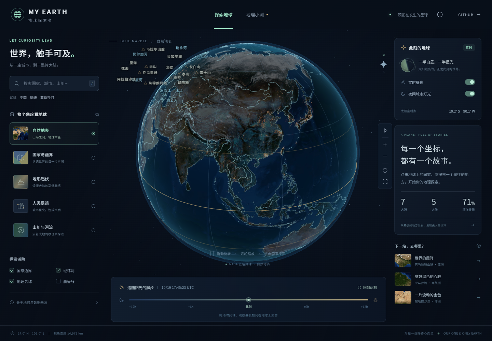

# My Earth · 地球探索者

一个面向中文用户的交互式 3D 地理学习页面。拖动地球，在国家、城市与山川之间探索，观察阳光如何在地球上移动。

**[在线体验 →](https://txzxin.github.io/my-earth/)**



## 能做什么

- **自由探索**：拖动旋转、鼠标滚轮 / 双指缩放、自动旋转、视角重置与全屏。
- **五种图层**：自然地表、国家与疆界、地形起伏、人类足迹、山川与河流。
- **中文搜索**：402 个国家、地区、主要城市与自然地标；支持中文、英文与别名，如“珠峰”“亚马逊河”；平滑飞行到目标坐标。
- **点击国土学习**：242 个国家与地区边界，展示名称、坐标、首都 / 首府、大洲、面积和带年份的人口数据。
- **实时昼夜**：根据当前 UTC 时间计算太阳直射点与晨昏线；夜半球显示城市灯光；时间轴可模拟前后 12 小时。
- **学习辅助**：经纬网、赤道 / 回归线、地理名称、国家边界与晨昏线开关，5 道地理小测，山川探索入口。
- **手机适配**：触屏旋转和双指缩放，纵向布局，不需要地图服务账号或 API 密钥。

## 本地运行

需要 Node.js 24（或 Vite 支持的较新 Node.js 版本）。

```bash
npm ci
npm run dev
```

打开终端打印的本地地址。所有运行所需的地理数据和纹理都随仓库保存，页面不调用外部地图、地理编码或字体服务。

```bash
npm run build     # 生成 dist/，使用相对路径，兼容 GitHub Pages 项目路径
npm run preview   # 预览生产构建
npm test          # 太阳位置、坐标转换、搜索、边界拾取与数据完整性
```

浏览器交互测试覆盖桌面与手机视口：

```bash
npx playwright install chromium
npm run test:e2e
```

Windows 如已安装 Edge，可直接使用：

```powershell
$env:PLAYWRIGHT_CHANNEL = 'msedge'
npm run test:e2e
```

## 项目结构

```text
src/main.js                中文界面、搜索、时间控制与地理小测
src/earth.js               Three.js 地球、昼夜 Shader、边界、标注和飞行相机
src/geo.js                 太阳位置、球面坐标与国土拾取计算
src/data/places.js         402 条离线地名索引
src/data/country-facts.js  国家与地区学习资料
public/assets/             地球贴图、边界、河流和数据许可
tests/                     单元测试与 Playwright 交互测试
.github/workflows/pages.yml  测试、构建与 GitHub Pages 发布
```

## 自动交付

推送到 `main` 后，GitHub Actions 依次执行依赖安装、7 项单元测试、14 项桌面 / 手机交互测试与生产构建；全部通过后发布到 GitHub Pages。Pull Request 执行相同验证，不发布页面。

## 关于数据与显示

日照范围根据 NOAA 太阳位置方程在浏览器内计算，每秒更新；**城市灯光与地表是静态合成贴图，并非实时卫星视频**。地形图层是相对高度着色，球面没有真实高程几何；山脉、河流、海洋用代表坐标进行搜索定位。

国家边界为 Natural Earth 1:50m 数据简化结果，河流为 1:110m 全球主要河流。面积依上游统计口径，人口标明约 2019 年估计值。详细来源、许可与数据说明见 [SOURCES.md](public/assets/SOURCES.md)。

Three.js / Vite 构建，使用 WebGL。可在支持 WebGL 的现代桌面和手机浏览器中运行。
